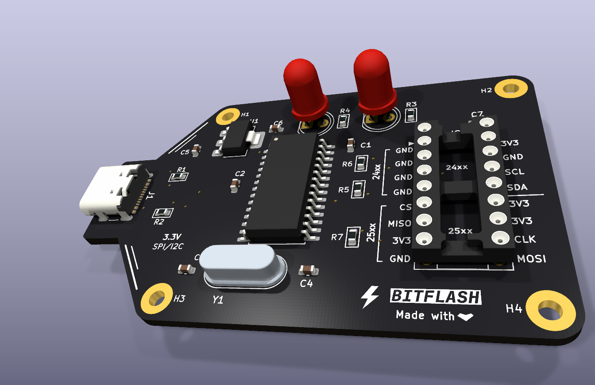
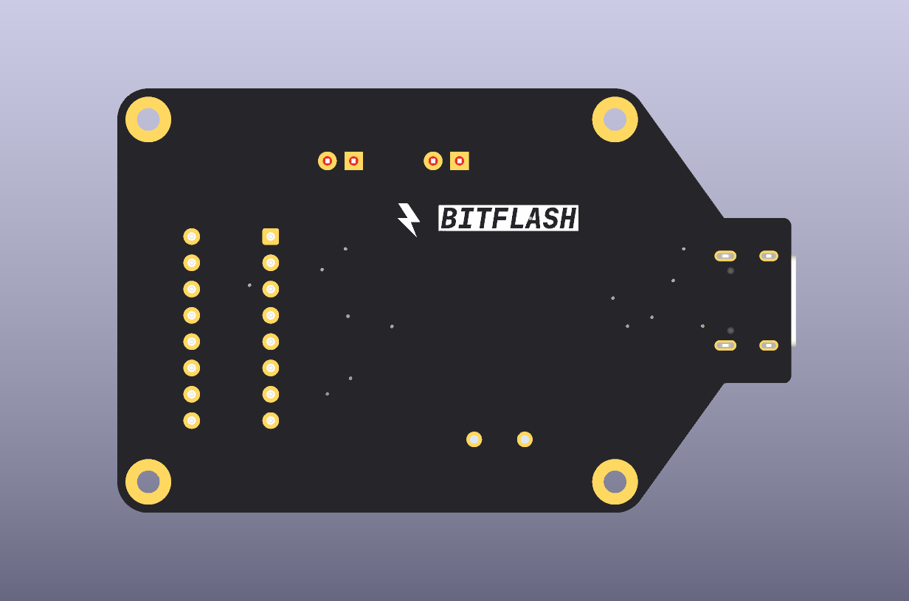
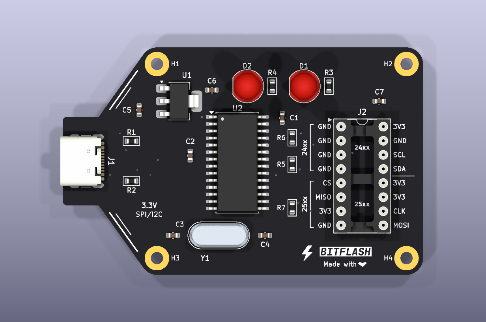
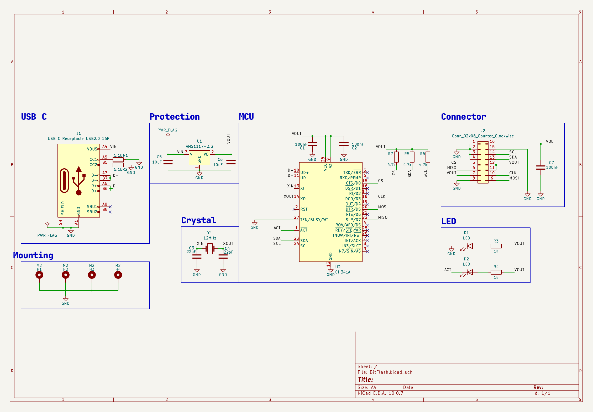

# BitFlash
A small USB C programmer for 25 series SPI flash and 24 series I2C EEPROMs  built around the WCH CH341A.

## Board Views

|                   Back                    |                   Front                   |
| :---------------------------------------: | :---------------------------------------: |
|  |  |

## Using the Target Socket (`J2`)

J2 is a standard 16 pin DIP socket split into two halves:
- Top half (Pins 1 to 4 / 13 to 16): 24xx I2C EEPROMs 
- Bottom half (Pins 5 to 12): 25xx SPI flash
## Schematic

## Software

BitFlash uses the fixed-function CH341A USB-to-SPI/I2C controller ASIC, so there is no onboard microcontroller . Host tools talk to it directly over USB.
## AI Disclosure
For this project AI was used for help me debug ERC and DRC issues.
